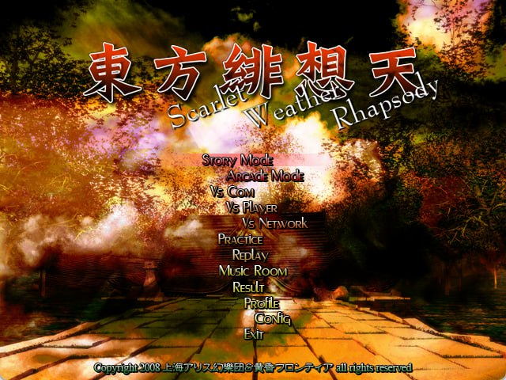
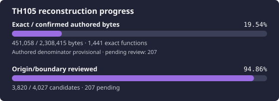

# 東方緋想天 ～ Scarlet Weather Rhapsody

Agent workflow: follow the highest-priority requirements in [AGENTS.md](AGENTS.md). Use affected exact checks and searchable Markdown knowledge; ordinary notes do not require full CI or replay.

<p align="center">
  
</p>

<p align="center">
  
</p>

This project reconstructs the original Japanese TH10.5 version 1.06a
executable with reproducible byte comparison as the acceptance criterion.

> [!NOTE]
> Reconstruction is still in progress. TH105 is a particularly challenging target,
> and a faithful, byte-exact reconstruction is expected to take considerable time.

## Exact target

Supply your own `resources/th105.exe`:

| Property | Required value |
| --- | --- |
| Version | original Japanese 1.06a |
| Size | `3,129,344` bytes |
| SHA-256 | `56350024879199861579c11b0e1c67b9590e10a8d40cd5996b109deec9afca7e` |
| MD5 | `2ae711a6c92c4addbdbf526bc61d8e59` |
| Image base | `0x00400000` |
| Entry point | `0x0068B9D2` |

The [official 1.06a updater](https://tasofro.net/touhou105/download.html),
`th105_update_106a.exe`, contains this executable. The old `th105c.exe`/1.06
target is different and is deliberately rejected.

```bash
scripts/import-target.sh /path/to/th105.exe
scripts/repo-python scripts/verify-target.py
```

Copyrighted executables and game data are not included.

## Workflow status

The project now uses the same conservative control-plane model as the TH08
reconstruction: mapping, source presence, exact matches, and library origin are
separate facts. TH105 keeps a separate provisional boundary/origin ledger
because the initial IDA pass reported 4,001 candidates and VC8 LTCG makes
naïve function/TU accounting unsafe. The current inventory and review count
come from `scripts/report-reconstruction-status.py --summary`.

The retained source tree came from the former 1.06 effort. Many functions have
since been revalidated against 1.06a and accepted into the source and exact
ledgers. Unselected retained files remain hypotheses, not 1.06a progress.

Start reconstruction or ledger work with:

```bash
scripts/repo-python scripts/verify-target.py
scripts/repo-python scripts/report-reconstruction-status.py --summary
scripts/repo-python scripts/validate-tracking.py --require-target
```

For IDA, prefer the Factory-native provider and freshly verify the target, all
five mapped-byte samples and analysis operations as specified in
[AGENTS.md](AGENTS.md) and [Factory IDA](docs/FACTORY_IDA_2026_10_29.md).
`scripts/check-ida-mcp.py` applies to the legacy bridge, not as a mandatory
prerequisite for an independently attested Factory session. Documentation and
test-workflow maintenance need no target/IDA preflight or native build.

## Documentation

- [Current handoff](docs/RE_HANDOFF.md)
- [Previous handoff archive](docs/RE_HANDOFF_HISTORY_2026_11_03.md)
- [Tenshi update resume notes](docs/TENSHI_OBJECT_UPDATE_2026_10_25.md)
- [AyaObject evidence and selected checkpoint](docs/AYA_OBJECT_EVIDENCE.md)
- [ReimuObject evidence and historical checkpoints](docs/REIMU_OBJECT_EVIDENCE.md)
- [Private artifacts and recovery](docs/ARTIFACTS.md)
- [Architecture and TH08/TH105 differences](docs/ARCHITECTURE.md)
- [Reverse-engineering workflow](docs/RE_WORKFLOW.md)
- [Tool routing](docs/TOOLS.md)
- [Historical evidence notebook](docs/KNOWLEDGE_BASE.md)
- [IDA MCP attestation](docs/IDA_MCP.md)
- [VC8 matching](docs/BUILD_MATCHING.md)
- [Generated progress](docs/PROGRESS.md)
- [Agent rules](AGENTS.md)

Use `scripts/repo-python` for repository Python commands. It checks the exact
CPython version in `.python-version`, all package versions in
`scripts/requirements-ci.txt`, and the importable decoder/emulator native APIs
before executing with that interpreter. Its default environment is `.venv`;
`TH105_PYTHON` can select another interpreter meeting the same locks.

Create the isolated environment with `uv`:

```bash
uv venv --python "$(cat .python-version)" .venv
uv pip install --python .venv/bin/python -r scripts/requirements-ci.txt
scripts/repo-python scripts/ci.py
```

With the exact configured CPython already installed, `python3 -m venv .venv`
and `.venv/bin/python -m pip install -r scripts/requirements-ci.txt` are equivalent
setup steps. GitHub Actions reads the same Python version file, installs those
dependencies into `.venv`, and uses the same launcher.

Default CI checks the ledgers, match-unit graph and strict comparison tooling;
it runs without game files, IDA or the proprietary compiler. Target-dependent
checks skip when the executable is absent. It checks progress artifacts without
rewriting them; run `scripts/repo-python scripts/progress.py` when ledger inputs
change.

The reconstruction loop is a focused VC8 build and whole-function exact
comparison. Allocation-failure/null-pointer coverage, broad execution matrices
and source/checkpoint snapshot tests are not routine acceptance requirements.
Optional analysis/probe tests can be run by filename with
`scripts/repo-python -m unittest discover -s tests -p 'test_NAME.py'`, or together
with `scripts/repo-python scripts/ci.py --all-tests`. They diagnose specific
questions and do not establish exactness.

## Pinned Boost reference headers

The native connect-menu comparison uses an unmodified Boost 1.40 header closure
as a compatible historical reference. On a network-enabled development machine:

```bash
scripts/repo-python scripts/upstream_boost.py --fetch
scripts/repo-python scripts/upstream_boost.py
```

The source lock pins immutable official commits and every original byte. Fetch
is explicit; native builds only verify and fail on missing/altered source.
Metadata-only CI does not download or require this SDK. The headers keep their
original Boost Software License 1.0. See
[reference identity and comparison evidence](docs/BOOST_REGEX_REFERENCE_2026_10_31.md).

The separate original narrow-instance library probe additionally requires
`scripts/repo-python scripts/upstream_boost.py --fetch --instances`; use
`--instances` without `--fetch` for offline verification. See
[library origin evidence](docs/BOOST_REGEX_LIBRARY_ORIGINS_2026_10_31.md).

## Isolated patched VC8 runtime reference

Some original-runtime provenance probes explicitly select Microsoft's KB971090
archive set. This never changes the active compiler or default link libraries.
Use `scripts/repo-python scripts/upstream_vc8_runtime.py` to verify it;
`--fetch` explicitly downloads/extracts the official package without running
the installer. Optional extraction dependencies and pinned source hashes are
documented in [runtime provenance](docs/VC8_PATCHED_RUNTIME_ORIGINS_2026_10_31.md).

## License

Repository-authored code and documentation are provided under the MIT License.
This does not grant rights to the original game or its assets.
