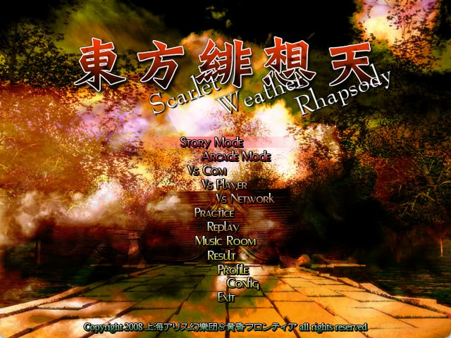
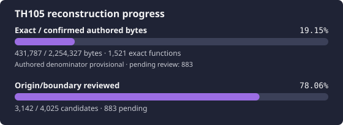

# 東方緋想天 ～ Scarlet Weather Rhapsody

<p align="center">
  
</p>

<p align="center">
  
</p>

This project reconstructs the original Japanese TH10.5 version 1.06a
executable with reproducible byte comparison as the acceptance criterion.

> [!NOTE]
> Reconstruction is still in progress. TH105 is a particularly challenging target,
> and a faithful, byte-exact reconstruction is expected to take considerable time.

## Exact target

Supply your own `resources/th105.exe`:

| Property | Required value |
| --- | --- |
| Version | original Japanese 1.06a |
| Size | `3,129,344` bytes |
| SHA-256 | `56350024879199861579c11b0e1c67b9590e10a8d40cd5996b109deec9afca7e` |
| MD5 | `2ae711a6c92c4addbdbf526bc61d8e59` |
| Image base | `0x00400000` |
| Entry point | `0x0068B9D2` |

The [official 1.06a updater](https://tasofro.net/touhou105/download.html),
`th105_update_106a.exe`, contains this executable. The old `th105c.exe`/1.06
target is different and is deliberately rejected.

```bash
scripts/import-target.sh /path/to/th105.exe
scripts/repo-python scripts/verify-target.py
```

Copyrighted executables and game data are not included.

## Workflow status

The project now uses the same conservative control-plane model as the TH08
reconstruction: mapping, source presence, exact matches, and library origin are
separate facts. TH105 keeps a separate provisional boundary/origin ledger
because the initial IDA pass reported 4,001 candidates and VC8 LTCG makes
naïve function/TU accounting unsafe. The current inventory and review count
come from `scripts/report-reconstruction-status.py --summary`.

The retained source tree came from the former 1.06 effort. Many functions have
since been revalidated against 1.06a and accepted into the source and exact
ledgers. Unselected retained files remain hypotheses, not 1.06a progress.

Start a session with:

```bash
scripts/repo-python scripts/verify-target.py
scripts/repo-python scripts/check-ida-mcp.py
scripts/repo-python scripts/report-reconstruction-status.py --summary
scripts/repo-python scripts/validate-tracking.py --require-target
```

## Documentation

- [Current handoff](docs/RE_HANDOFF.md)
- [Previous handoff archive](docs/RE_HANDOFF_HISTORY_2026_10_26.md)
- [Tenshi update resume notes](docs/TENSHI_OBJECT_UPDATE_2026_10_25.md)
- [AyaObject evidence and selected checkpoint](docs/AYA_OBJECT_EVIDENCE.md)
- [ReimuObject evidence and historical checkpoints](docs/REIMU_OBJECT_EVIDENCE.md)
- [Private artifacts and recovery](docs/ARTIFACTS.md)
- [Architecture and TH08/TH105 differences](docs/ARCHITECTURE.md)
- [Reverse-engineering workflow](docs/RE_WORKFLOW.md)
- [Tool routing](docs/TOOLS.md)
- [Historical evidence notebook](docs/KNOWLEDGE_BASE.md)
- [IDA MCP attestation](docs/IDA_MCP.md)
- [VC8 matching](docs/BUILD_MATCHING.md)
- [Generated progress](docs/PROGRESS.md)
- [Agent rules](AGENTS.md)

Use `scripts/repo-python` for repository Python commands. It checks the exact
CPython version in `.python-version`, all package versions in
`scripts/requirements-ci.txt`, and the importable decoder/emulator native APIs
before executing with that interpreter. Its default environment is `.venv`;
`TH105_PYTHON` can select another interpreter meeting the same locks.

Create the isolated environment with `uv`:

```bash
uv venv --python "$(cat .python-version)" .venv
uv pip install --python .venv/bin/python -r scripts/requirements-ci.txt
scripts/repo-python scripts/ci.py
```

With the exact configured CPython already installed, `python3 -m venv .venv`
and `.venv/bin/python -m pip install -r scripts/requirements-ci.txt` are equivalent
setup steps. GitHub Actions reads the same Python version file, installs those
dependencies into `.venv`, and uses the same launcher.

Public checks run without game files, IDA, or the proprietary compiler.
Synthetic execution tests use the pinned Unicorn package. Tests that inspect
the canonical executable explicitly skip when it is absent; when present,
its identity and evidence checks still run. Local target and IDA checks remain
separate.

## License

Repository-authored code and documentation are provided under the MIT License.
This does not grant rights to the original game or its assets.
